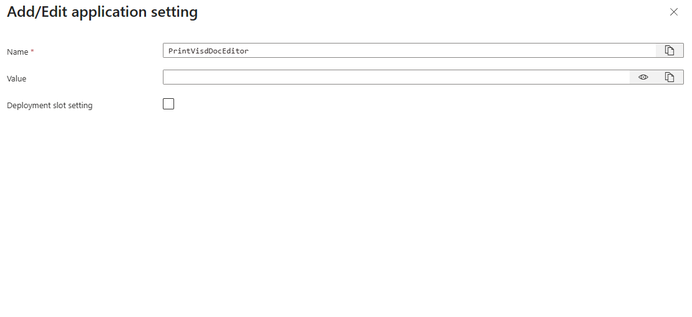

# Welcome to learn.printvis.com

## About this documentation

This site contains product documentation for PrintVis.

For company information, news, and official content, please visit the official <a href="https://printvis.com" target="_blank" rel="noopener noreferrer">PrintVis website</a>.

## What is PrintVis?

**PrintVis is Microsoft-certified business management software built specifically for the print and packaging industry.**

It provides a complete cloud-based system to help you manage your operations efficiently and scale with your business.

## Powered by Microsoft Dynamics 365 Business Central

PrintVis combines the business management tools of Microsoft Dynamics 365 Business Central with specialized print functionality, covering:

- Estimating and quoting
- Order management
- Planning and scheduling
- Shop floor control
- Inventory and purchasing
- Job costing
- Financial management

## Who is PrintVis for?

PrintVis supports businesses producing:

- Books
- Labels
- Packaging
- Apparel
- Large-format print
- Commercial print

## Explore the learning resources

Discover how to make the most of PrintVis powered by Business Central through training, documentation, videos, and how-to articles.

Learn how to use PrintVis to manage, adapt, and streamline your operation.

